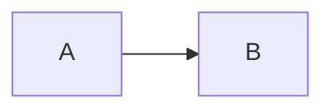

# 見出し1

段落なのだ。**強調**と`インラインコード`と[リンク](https://example.com)がある。
複数行にまたがる段落なので data-src-end-line が付く。

## 見出し2

- リスト1
- リスト2
  - ネストしたリスト

1. 数字リスト
2. ふたつめ

- [ ] タスク未完了
- [x] タスク完了

> ふつうの引用なのだ。

> [!NOTE]
> Note アラート。

> [!WARNING]
> Warning アラート。

| 左寄せ | 右寄せ |
|:-------|-------:|
| a      | b      |

```rust
fn plain() {}
```

```rust:src/named.rs
fn named() {}
```



```drawio
<mxGraphModel><root>A &amp; "B"</root></mxGraphModel>
```

<details>
<summary>折りたたみ</summary>

中身なのだ。

</details>

[埋め込み](./embed.txt#L2-L3)

脚注つきの文[^1]。

[^1]: 脚注の中身なのだ。

~~打ち消し線~~ と [[WikiLink]] 。

外部の画像は既定で「開く」リンクになる: 
バッジ: [](https://example.com/ci)

太字</b> & 記号">
