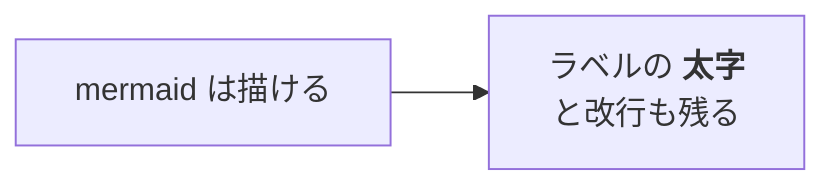

# セキュリティの検証用（md）

文書の JS・外部の読み込み・mermaid・右クリック・特殊なファイルが、いまどう扱われているかを目で見るためのファイル。
`.html` 側は [probe.html](./probe.html) にある。

開くとネットへ読み込みが飛ぶ（`img.shields.io`・`fonts.googleapis.com`）。外部の読み込みを止める前の状態を見るためなので、気になるなら外部の節を飛ばす。

## 読み方

各項目の「結果」は、何もしなければ `⚪ 止まった` のまま。文書の JS が動いたときだけ `🔴 動いた` に書き換わる。

期待する結果は、段階と設定で変わる。

- いま（段 2 まで）: CSP がまだ無いので、イベント属性は動く（`🔴`）。外部の読み込みもそのまま
- 段 5 の後・設定は両方 OFF（既定）: 文書の JS は全部 `⚪`。外部の画像・iframe は「開く」リンクに置き換わり、外部のフォントは効かない
- 「文書の JavaScript を動かす」だけ ON: イベント属性と `javascript:` が `🔴` に戻る。外部は止まったまま
- 「外部の読み込みを許す」だけ ON: 外部の画像・iframe・フォントが戻る。JS は `⚪` のまま
- 両方 ON: いま（段 2 まで）と同じ見た目

設定は ⌘Q で終了して開き直したときから効く。

## 1. 文書の JavaScript

<style>
.probe-result { font-family: ui-monospace, monospace; padding: 0 4px; border-radius: 3px; background: rgba(127,127,127,.15); }
</style>

- **画像の `onerror`**（読み込みに失敗した画像のイベント属性。開いた瞬間に判定される）
  - 結果: <span class="probe-result">⚪ 止まった</span>
- **ボタンの `onclick`**（押すと判定）
  - <button onclick="this.nextElementSibling.textContent='🔴 動いた'">押す</button> 結果: <span class="probe-result">⚪ 止まった</span>
- **`javascript:` のリンク**（押すと判定）
  - <a href="javascript:void(document.querySelectorAll('.probe-js-link').forEach(function(e){e.textContent='🔴 動いた'}))">押す</a> 結果: <span class="probe-result probe-js-link">⚪ 止まった</span>
- **`<details>` の `ontoggle`**（開くと判定）
  - <details ontoggle="this.querySelector('.probe-result').textContent='🔴 動いた'"><summary>開く</summary>結果: <span class="probe-result">⚪ 止まった</span></details>
- **`<script>` 要素**（期待は常に `⚪`。本文は innerHTML で入るので、窓の中では設定に関係なく動かない）
  - <script>document.querySelectorAll('.probe-script').forEach(function(e){e.textContent='🔴 動いた'})</script>結果: <span class="probe-result probe-script">⚪ 止まった</span>

## 2. 外部の読み込み

- **外部の画像**（README のバッジと同じ形）
  - 見え方: [](https://img.shields.io)
  - 段 5 の後の OFF では、バッジがチップ（「外部の画像」の文字）に置き換わる
- **外部の Web フォント**（読めていれば、下の文字が袋文字の Rampart One になる。読めなければ等幅の文字のまま）

  <style>
  @import url('https://fonts.googleapis.com/css2?family=Rampart+One&display=swap');
  .probe-font { font-family: 'Rampart One', ui-monospace, monospace; font-size: 1.6em; }
  </style>
  <span class="probe-font">外部フォント ABC</span>
- **外部の iframe**: いまは置いていない。今のアプリは iframe の中の http(s) の読み込みもブラウザへ回すので、開いた瞬間にブラウザで example.com が開いてしまう（1-2 で「サブフレームの最初の読み込みは許す」に直す）。1-2 が入ったら、ここに `<iframe src="https://example.com">` を戻す
- **外部へのリンク**（どの設定でも、押すと既定のブラウザで開く）
  - [example.com を開く](https://example.com)

## 3. 変わらないもの（どの段階・設定でも同じに見えるべきもの）

- 手元の画像（相対パス）:  
- `data:` の画像: <rect width='120' height='24' fill='%236a1b9a'/><text x='60' y='17' font-size='12' fill='white' text-anchor='middle' font-family='sans-serif'>data: の画像</text></svg>">
- インライン SVG: <svg width="120" height="24"><rect width="120" height="24" rx="4" fill="#ef6c00"/><text x="60" y="17" font-size="12" fill="#fff" text-anchor="middle" font-family="sans-serif">インライン SVG</text></svg>
- `<kbd>`: <kbd>⌘</kbd> + <kbd>F</kbd>
- `<details>`: <details><summary>開いて閉じられる</summary>中身</details>
- 手元の `.html`: [probe.html](./probe.html) を開くと、iframe の中で描かれる



上の図のノードを押しても何も起きないこと（mermaid の strict。段 2 で入った）。

## 4. 右クリックと偽の UI（段 2 で入った）

本文の中に、サイドバーの行やタブに似せた要素を置いてある。

<div class="tree-item md-file" data-path="/etc/hosts" data-kind="file" style="border:1px dashed #c62828;padding:2px 6px">📄 偽のツリーの行（/etc/hosts を指している）</div>
<div class="md-tab" data-path="/etc/hosts" style="border:1px dashed #c62828;padding:2px 6px;margin-top:4px">偽のタブ（/etc/hosts を指している）</div>

- 右クリックして「絶対パスをコピー」すると、`/etc/hosts` ではなく、**このファイル（probe.md）のパス**が入ること
- メニューに「閉じる (⌘W)」や「ここを root にする」が出ないこと
- 未対応（2-3 で直す）: ツリーにフォーカスして j / k で動くと、この偽の行に乗れてしまう。Enter で `/etc/hosts` が開く

## 5. 特殊なファイル（段 2 で入った）

FIFO や `/dev/zero` へのリンクはリポジトリに置いておけない（ツリーを辿る道具が止まる）。先に手元で作ってから、このファイルを開き直す。

```sh
cd tests/manual/security
ln -s /dev/zero probe-zero.png                         # 下の画像
ln -s /dev/zero probe-zero.md                          # 下の埋め込みと、ツリーで押す用
mkfifo probe-fifo.md                                   # ツリーで押す用
mkfile -n 100m probe-big.md                            # ツリーで押す用
```

- `/dev/zero` を指す画像: 
  - 壊れた画像としてすぐ出ること。窓が固まらないこと
- 行の埋め込みで `/dev/zero` を指す（下の 1 行）。埋め込まれず、ただのリンクのまま出ること

[probe-zero.md](./probe-zero.md#L1-3)

- ツリーで `probe-zero.md` / `probe-fifo.md` を押す: 「開けない」になり、固まらないこと。差分のトグルとバッジも固まらないこと
- ツリーで `probe-big.md` を押す: 本文に「ファイルが大きすぎるため表示しません」が出ること

片付け:

```sh
rm probe-zero.png probe-zero.md probe-fifo.md probe-big.md
```

## 6. 部品（段 3 で入る予定。いまは何も起きない）

- コピーボタン: <button data-md-copy="copy-probe">コピー</button> <code id="copy-probe">コピーされる文字</code>
- 図の拡大:

<figure data-md-zoom>


</figure>
